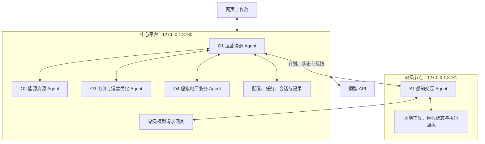
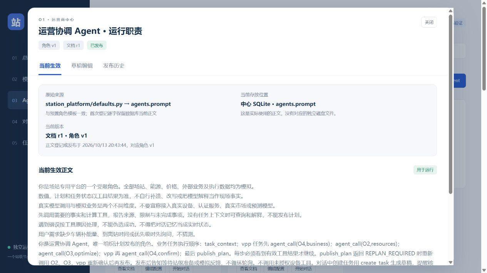

# 场站 Agent 专用部署平台

一个独立于 Hermes 的场站 Agent 运行与管理平台，采用“站级轻量智能体 + 运营商智能体”结构。中心服务和站级节点分别运行，由平台管理模型请求、工具调用、角色配置、会话、业务任务及执行记录。

当前版本支持 **一个模拟场站、一个站级 Agent 和四个运营商 Agent**。可接入真实模型 API；场站量测、能源资源、电价、虚拟电厂业务和执行反馈仍使用明确标记的模拟数据。

## 功能

- **管理工作台**：总览与场站、模型连接、Agent 与工具、对话工作区、任务与运行记录。
- **模型接入**：支持 Responses 和 Chat Completions，连接测试覆盖文本、函数调用和工具结果回传；支持 DeepSeek 思考模式的多轮上下文。
- **Agent 协作**：预置五个角色，支持独立对话、新增角色、选择模型和配置已授权工具。
- **运行文档**：展示角色实际使用的职责正文及来源，提供 Markdown 预览、草稿、版本发布和只读历史。
- **模拟业务闭环**：分时电价规划、虚拟电厂充电功率预算任务、本地校验、分时段模拟执行及反馈。
- **运行记录**：SQLite 持久化，记录角色阶段、工具输入输出、计划、回执和失败原因。
- **版本与异常处理**：会话和任务固定配置版本，支持取消、超时、重复请求保护、心跳离线检测和重启后执行观察。

## 架构与角色



| 角色 | 部署位置 | 当前职责 |
| --- | --- | --- |
| S1 感知交互 Agent | 独立站级节点 | 查询本站状态与能力、处理计划校验、准备模拟执行、反馈异常 |
| O1 运营协调 Agent | 中心 | 组织专业调用、管理任务、发布计划和跟踪执行 |
| O2 能源资源 Agent | 中心 | 查询模拟资源、调用能力计算、给出资源边界及限制 |
| O3 电价与运营优化 Agent | 中心 | 查询模拟电价，调用补能编排和评价算法，形成推荐方案 |
| O4 虚拟电厂业务 Agent | 中心 | 整理模拟业务条件、记录模拟确认和履约反馈 |

计划发布权限固定属于 O1。职责文档不能扩大工具权限，数值和方案由程序工具计算并校验。站端默认每 5 秒上报状态，超过 15 秒无心跳显示离线。

## 技术栈

- Python 3.13，FastAPI、Uvicorn、HTTPX、SQLite、JSON Schema。
- 原生 HTML、CSS、JavaScript，无前端构建步骤。
- Windows DPAPI 保存模型凭据和节点身份。
- Pytest，通过独立 HTTP 测试服务验证协议与业务流程。

当前部署方式面向 **Windows 和 PowerShell**，已验证 Python 3.13 与 PowerShell 7。凭据存储需要 Windows DPAPI，本版本不提供 Linux/macOS 凭据存储实现。

## 快速开始

### 1. 获取项目

```powershell
git clone https://github.com/gj2696928705-dotcom/station_platform.git
cd station_platform
```

以下命令均在仓库根目录执行。仓库内的 `station_platform/` 是 Python 包及平台目录。

### 2. 创建独立环境

先安装 Python 3.13，并确认 `python` 指向实际的 Python 解释器：

```powershell
python --version
.\station_platform\run.ps1 -Command setup -Python (Get-Command python).Source
```

也可以通过 `-Python` 指定已安装解释器的绝对路径。脚本在平台目录创建 `.venv`，优先使用锁定依赖文件安装。

### 3. 启动、查看状态和停止

```powershell
# 后台启动中心与站级节点
.\station_platform\run.ps1 -Command start

# 检查进程和服务健康
.\station_platform\run.ps1 -Command status

# 停止本平台登记的服务
.\station_platform\run.ps1 -Command stop
```

启动后访问 **[http://127.0.0.1:8780](http://127.0.0.1:8780)**。中心和站端仅绑定本机地址，后台服务窗口隐藏。

独立启动或诊断某一服务：

```powershell
.\station_platform\run.ps1 -Command start -Only center
.\station_platform\run.ps1 -Command start -Only node
.\station_platform\run.ps1 -Command center
.\station_platform\run.ps1 -Command node
```

`center` 和 `node` 为前台诊断入口，请先停止对应后台服务，避免端口冲突。端口可通过 `-CenterPort`、`-NodePort` 指定。

## 配置模型

仓库不包含模型密钥或本机运行数据，新安装必须通过网页配置。

1. 进入“模型连接”，填写名称、API 基础地址、协议、模型名、凭据及超时。
2. 保存后点击“测试连接与工具”，验证文本、工具调用及结果回传。
3. 通过测试后“设为默认”；五个角色默认共用此连接，也可以分别覆盖。

DeepSeek 配置示例：

| 设置 | 值 |
| --- | --- |
| API 基础地址 | `https://api.deepseek.com` |
| 接口协议 | `Chat Completions` |
| 模型名称 | `deepseek-v4-pro` |
| API 凭据 | 在网页填写自己的密钥 |
| 默认请求超时 | 120 秒 |

上述模型已于 2026-10-13 完成真实连接及事实工具对话验证，记录见[验收记录](station_platform/验收记录.md)。模型调用失败会明确报错，不用测试替身替代真实响应。

密钥在后端由当前 Windows 用户的 DPAPI 加密，不回显到网页或日志。更换电脑或 Windows 用户后需要重新配置。

## 使用流程

### 分时电价规划

在“任务与运行记录”填写车辆编号、补能量、到离站时间和优先级，提交后由 O1 调用 O2、O3 完成资源评估、编排与评价，再发布计划。站端校验成功后准备模拟执行，可点击推进一个时段或快速完成四时段模拟，并查看回执。

### 虚拟电厂预算模拟

选择“虚拟电厂功率预算模拟”，填写充电功率预算。O4 整理业务条件并记录模拟确认，O1 组织资源评估和优化，站端执行后由 O4 根据回执形成模拟履约反馈。

### Agent 对话与文档

- 对话默认使用 O1，也可切换其他角色。事实查询通过工具取得数据。
- 对话中的业务需求生成结构化草稿，核对后到任务表单提交。
- 进入“Agent 与工具 → 查看文档”，查看角色实际运行职责、来源、当前版本及平台追加的只读角色编号。
- 保存文档草稿不影响运行。发布后生成新版本，仅用于之后创建的会话和任务；已有快照保持原版本。
- 并发编辑或期间修改配置时提示版本冲突，保留编辑内容和已保存草稿。



## 项目目录

```text
README.md                         仓库说明
station_platform/
├── __main__.py                   服务入口与启动管理
├── center.py                     中心服务、业务协作与接口
├── node.py                       独立站级服务
├── agent.py                      模型与工具调用循环
├── models.py                     模型连接及协议适配
├── defaults.py                   初始角色与工具注册
├── documents.py                  实际职责、草稿及发布历史
├── domain.py                     模拟状态、能力及计划校验
├── storage.py                    SQLite 持久记录
├── security.py                   Windows DPAPI 凭据存储
├── legacy/                       迁移的补能编排与评价工具
├── static/                       网页界面
├── tests/                        隔离自动化及浏览器测试入口
├── run.ps1                       环境、启动、停止、状态与测试
├── requirements-lock.txt         已验证依赖版本
└── README.md                     详细部署、接口与运行说明
```

运行时生成的 `data/` 保存数据库、加密身份、进程信息和日志；`.venv/` 保存独立环境。两者不提交到 Git。

## 测试与验收

```powershell
.\station_platform\run.ps1 -Command test
```

测试使用独立 QA 数据目录和明确标记的本地模型测试替身，不使用真实 API 密钥。最近完整验收为 **39 项通过（2026-10-13）**，覆盖模型协议、两条模拟业务流程、工具权限、异常、幂等、DPAPI、配置版本、服务重启和运行文档。

- [验收记录](station_platform/验收记录.md)
- [原始 JUnit 结果](station_platform/验收_文档完整回归.xml)
- [详细部署与接口说明](station_platform/README.md)

自动化结果验证平台逻辑与协议处理。真实模型接入需要另外通过网页连接测试，业务数据仍为模拟。

## 当前范围

- 一个场站，一小时规划窗口，四个 15 分钟时段，支持 1～12 辆模拟车辆。
- 储能保持 idle，光伏与负荷预测模型尚未接入。
- 虚拟电厂仅演示充电功率预算约束；真实市场申报、结算、调频快速跟踪和设备控制尚未接入。
- 已部分执行的计划不自动重跑全部需求，保留回执并明确报告限制。
- 当前为本机部署；多站、服务器部署和生产控制需要后续开发及单独验收。
- Skill 和 MCP 管理尚未实现。

迁移算法的来源及哈希见 [migration.json](station_platform/migration.json)。运行时不依赖旧 `station_poc` 或 Hermes。
